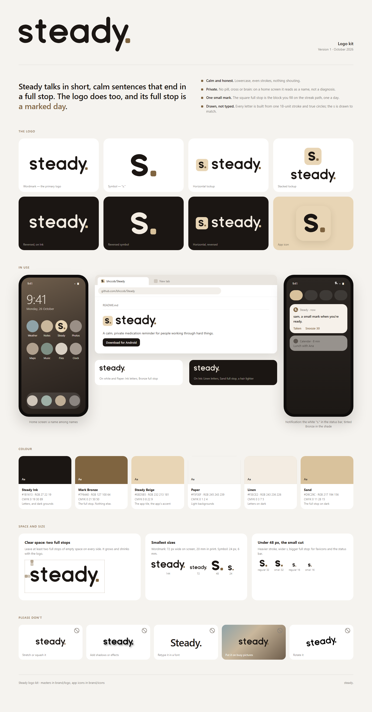

# Steady logo kit



## The idea

Steady talks in short, calm sentences that end in a full stop ("sam.", "Today."). The logo does too: **steady.** in quiet lowercase, with the full stop drawn as a small square block. That block is a marked day, the same block you fill on the streak path. There's no pill, cross or brain, so the logo on a home screen reads as a name, not a diagnosis.

## Versions

| Version | When to use it | File |
|---|---|---|
| Wordmark | The main logo, wherever there's room | `logo/steady-wordmark.svg` |
| Symbol "s." | Square spaces: avatars, app tiles, stickers | `logo/steady-symbol.svg` |
| Symbol, small cut | 48 px and under: favicons, the status bar | `logo/steady-symbol-small.svg` |
| Horizontal lockup | Headers, the GitHub page | `logo/steady-horizontal.svg` |
| Stacked lockup | Square or tall layouts, slides | `logo/steady-stacked.svg` |
| App icon | Store listings, mockups | `logo/steady-app-icon.svg` |

Each comes in colour, `-reversed` (for dark backgrounds), `-black` and `-white` where it makes sense. The SVGs in `logo/` are the masters. Use them for screens and print. `png/` has ready-made PNG copies.

## Clear space

Leave at least **two full stops** of empty space around the logo on every side. Measure with the logo's own full stop, so the space grows and shrinks with it.

## Smallest sizes

| Version | Screen | Print |
|---|---|---|
| Wordmark | 72 px wide | 20 mm wide |
| Symbol | 24 px | 6 mm |
| Symbol, small cut | 16 px | 4 mm |

## Colour

| Name | HEX | RGB | CMYK (approx.) | Use |
|---|---|---|---|---|
| Steady Ink | `#1B1613` | 27 22 19 | 0 19 30 89 | Letters; dark backgrounds |
| Mark Bronze | `#7F6440` | 127 100 64 | 0 21 50 50 | The full stop, and nothing else |
| Steady Beige | `#E8D5B5` | 232 213 181 | 0 8 22 9 | The app tile; the app's accent |
| Paper | `#F5F3EF` | 245 243 239 | 0 1 2 4 | Light backgrounds |
| Linen | `#F3ECE2` | 243 236 226 | 0 3 7 5 | Letters on dark |
| Sand | `#D9C29C` | 217 194 156 | 0 11 28 15 | The full stop on dark |

**Logo on background pairs:**
- Colour on Paper, white or Beige: Ink on Paper 16.2:1, Bronze on Beige 3.9:1.
- Reversed on Ink: Linen 15.3:1, Sand 10.4:1.
- Black on white.
- White on Bronze or on photos, on a calm area.

The reversed versions are drawn one unit lighter, because light letters on a dark ground look heavier than they are. The CMYK values are straight conversions. Ask the printer to match them, and to choose a Pantone if one is needed; no Pantone has been matched.

## Type

The wordmark is drawn, not typed: every letter is built from one 18-unit stroke and true circles, with an s drawn to match. Never retype it. Around the logo, the app uses the phone's system font at weights 400 and 600.

## Please don't

Don't stretch, squash or rotate it. Don't recolour it outside the palette, or colour anything but the full stop Bronze. Don't add shadows, outlines, gradients or effects. Don't move or resize the parts of a lockup. Don't put it on a busy picture without a calm area. Don't retype it in a font.

## App and web icons

- `icons/app/`: the app icons.
  - `icon-1024.png`: iOS and Expo. Full-bleed; the system rounds the corners.
  - `adaptive-foreground-1024.png` and `adaptive-monochrome-1024.png`: Android adaptive and themed icons, on Beige.
  - `notification-96.png`: the white status-bar icon, small cut.
  - `play-store-512.png`: the Play Store listing icon.
- `icons/web/`: the web icons.
  - `favicon.ico`, `favicon.svg` and favicon PNGs at 16, 32 and 48 px.
  - `apple-touch-icon.png` and the PWA icons.
  - `site.webmanifest`, plus `head-snippet.html` with the tags to paste into a page.

The app uses copies of these icons in `/assets`, and `app.json` points there. Icon changes show up in the next build (`eas build`), not in a running app.

## Remaking the files

Everything here comes from one script, `source/build-logo.cjs`, which holds every measurement. Change a number there and run this from the repo root:

```bash
npm install --no-save @resvg/resvg-js@2.6.2
node brand/source/build-logo.cjs
```

It rewrites `logo/`, `png/` and `icons/`, and the app's copies in `/assets`. The board is `board/steady-logo-board.html`. Open it in a browser, or re-screenshot it for the PNG. `concepts/` keeps the three first-round directions, for the record.

## Open items

- Trademark: no clearance search has been done. Search the trademark registers (for example WIPO's Global Brand Database) and run a reverse image search before you register the name or the logo, or rely on them commercially.
- Print: the CMYK values above haven't been proofed, and no Pantone has been matched.
